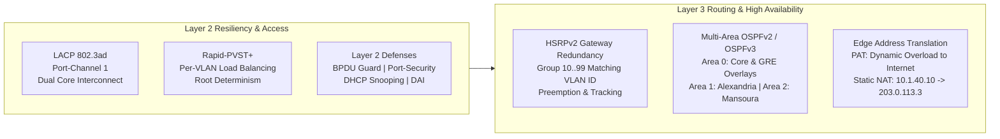
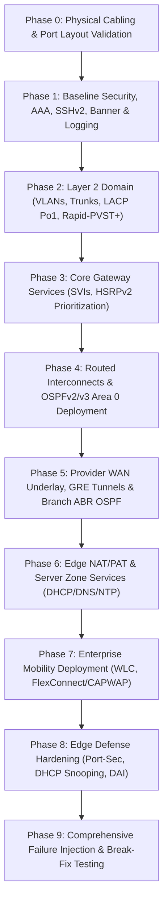

# Enterprise Multi-Branch Campus & WAN Infrastructure Design
### Production-Grade CCNA 200-301 Reference Architecture & Capstone Implementation

---

## 1. Executive Summary & Architecture Overview

This project delivers a multi-site enterprise network infrastructure designed for **LAB-Corp**, an enterprise headquartered in Cairo with branch offices in Alexandria and Mansoura. The topology is engineered to satisfy production enterprise requirements: high availability (HA), zero single points of failure (SPOF) in the distribution layer, strict multi-tenant segmentation, resilient WAN overlay transport across an untrusted provider, and a dual-stack IPv4/IPv6 edge.

### Core Architectural Pillars
* **High Availability & Fault Isolation:** Dual-homed Layer 2 to Layer 3 aggregation running First-Hop Redundancy Protocols (HSRPv2), deterministic Layer 2 spanning-tree election (Rapid-PVST+), and multi-chassis link bundling (LACP 802.3ad).
* **Deterministic Layer 3 Fabric:** Multi-area Open Shortest Path First (OSPFv2 & OSPFv3) routing topology with explicit administrative boundary enforcement (ABRs) and loopback-based management peering.
* **Secure Hybrid WAN Transport:** Point-to-point GRE overlay tunnels crossing a simulated public ISP cloud with dynamic routing overlay and perimeter access control matrices.
* **Identity-Aware Edge & Wireless:** Enterprise wireless mobility utilizing split-MAC architecture (Cisco WLC + Lightweight APs) with segregated Corporate and Guest execution environments.
* **Zero-Trust Hardening:** Layer 2 defense-in-depth including DHCP Snooping, Dynamic ARP Inspection (DAI), IEEE 802.1Q Native VLAN hygiene, and hardware port-security with violation rate-limiting.

---

## 2. Global Topology Architecture (Interactive Mermaid Diagram)

> **GitHub Rendering Note:** The diagram below renders automatically on GitHub using Mermaid.js to depict campus distribution, routed uplinks, simulated ISP WAN boundaries, and branch demarcations.

```mermaid
flowchart TB
    %% ================= GLOBAL STYLING =================
    classDef hqBox fill:#f0f4f8,stroke:#1e3a8a,stroke-width:2px;
    classDef brBox fill:#f0fdf4,stroke:#166534,stroke-width:2px;
    classDef ispBox fill:#fbfbfe,stroke:#6b21a8,stroke-width:2px,stroke-dasharray: 5 5;
    
    classDef router fill:#1e40af,stroke:#1e3a8a,stroke-width:2px,color:#ffffff;
    classDef coreSwitch fill:#0f766e,stroke:#115e59,stroke-width:2px,color:#ffffff;
    classDef accSwitch fill:#334155,stroke:#1e293b,stroke-width:2px,color:#ffffff;
    classDef infraSrv fill:#c2410c,stroke:#9a3412,stroke-width:2px,color:#ffffff;
    classDef wlanDev fill:#7e22ce,stroke:#581c87,stroke-width:2px,color:#ffffff;
    classDef host fill:#ffffff,stroke:#64748b,stroke-width:1px,color:#0f172a;

    %% ================= HEADQUARTERS =================
    subgraph HQ ["🏢 HEADQUARTERS - CAIRO | IPv4: 10.1.0.0/16 | IPv6: 2001:db8:1::/48 | OSPF Area 0"]
        direction TB

        subgraph HQ_Hosts ["Endpoint & Compute Tier"]
            PC_Sales["Sales Endpoints<br/>(VLAN 10 / Voice 50)"]:::host
            PC_IT["IT Management Nodes<br/>(VLAN 20)"]:::host
            AP1["AP1 (Catalyst 9120 / LAP)<br/>(VLAN 99)"]:::wlanDev
            PC_HR["HR Endpoints<br/>(VLAN 30)"]:::host
            SRV_FARM["Enterprise Core Services<br/>SRV-HQ1 (.10) | SRV-HQ2 (.11)<br/>(VLAN 40)"]:::infraSrv
            WLC1["WLC1 (Catalyst 9800-L / WLC-PT)<br/>Mgmt: 10.1.99.10"]:::wlanDev
        end

        subgraph HQ_Access ["Campus Access Switching (Layer 2)"]
            HQ_SW1["HQ-SW1 (Catalyst 2960)<br/>Fa0/1-8: Sales | Fa0/9-16: IT | Fa0/24: AP1"]:::accSwitch
            HQ_SW2["HQ-SW2 (Catalyst 2960)<br/>Fa0/1-8: HR | Fa0/20-21: Srvs | Fa0/23: WLC"]:::accSwitch
        end

        subgraph HQ_Core ["Campus Distribution / Core (Layer 3 Switching)"]
            HQ_CORE1["HQ-CORE1 (Catalyst 3650-24PS)<br/>HSRP Active / STP Root: 10, 20, 30, 50<br/>Router-ID: 10.1.254.11"]:::coreSwitch
            HQ_CORE2["HQ-CORE2 (Catalyst 3650-24PS)<br/>HSRP Active / STP Root: 40, 60, 61, 99<br/>Router-ID: 10.1.254.12"]:::coreSwitch
        end

        HQ_R1["HQ-R1 (ISR 4331 / 2911 Edge)<br/>NAT Overload | Static NAT | GRE Hub<br/>Router-ID: 10.1.254.1"]:::router

        %% HQ Cabling
        PC_Sales --- HQ_SW1
        PC_IT --- HQ_SW1
        AP1 --- HQ_SW1

        PC_HR --- HQ_SW2
        SRV_FARM --- HQ_SW2
        WLC1 ===|802.1Q Trunk 60,61,99| HQ_SW2

        HQ_SW1 ===|Gi0/1 - Gi1/0/3 Trunk| HQ_CORE1
        HQ_SW1 ===|Gi0/2 - Gi1/0/3 Trunk| HQ_CORE2
        HQ_SW2 ===|Gi0/1 - Gi1/0/4 Trunk| HQ_CORE1
        HQ_SW2 ===|Gi0/2 - Gi1/0/4 Trunk| HQ_CORE2

        HQ_CORE1 ===|Po1 (Gi1/0/1-2) LACP Trunk| HQ_CORE2

        HQ_CORE1 ---|Gi1/0/10 - G0/0<br/>Routed /30: 10.1.255.0/30| HQ_R1
        HQ_CORE2 ---|Gi1/0/10 - G0/1<br/>Routed /30: 10.1.255.4/30| HQ_R1
    end

    %% ================= ISP CORE =================
    subgraph ISP ["☁️ UNTRUSTED WAN TRANSPORT (Simulated Provider)"]
        ISP_R1["ISP-R1 (Core Edge Gateway)<br/>Public Subnet: 203.0.113.0/24<br/>Loopback0: 198.51.100.1/32 (Internet Host)"]:::router
    end

    %% ================= BRANCH 1 =================
    subgraph BR1 ["🏬 BRANCH 1 - ALEXANDRIA | IPv4: 10.2.0.0/16 | OSPF Area 1"]
        BR1_R1["BR1-R1 (Branch Edge Router)<br/>Router-on-a-Stick | Local DHCP<br/>Router-ID: 10.2.254.1"]:::router
        BR1_SW1["BR1-SW1 (Access 2960)"]:::accSwitch
        BR1_Hosts["Staff Endpoints<br/>(VLAN 10: 10.2.10.0/24)"]:::host

        BR1_R1 ===|G0/0 - Gi0/1 802.1Q Trunk| BR1_SW1
        BR1_SW1 --- BR1_Hosts
    end

    %% ================= BRANCH 2 =================
    subgraph BR2 ["🏬 BRANCH 2 - MANSOURA | IPv4: 10.3.0.0/16 | OSPF Area 2"]
        BR2_R1["BR2-R1 (Branch Edge Router)<br/>Router-on-a-Stick | DHCP Relay -> SRV-HQ1<br/>Router-ID: 10.3.254.1"]:::router
        BR2_SW1["BR2-SW1 (Access 2960)"]:::accSwitch
        BR2_Hosts["Staff Endpoints<br/>(VLAN 10: 10.3.10.0/24)"]:::host

        BR2_R1 ===|G0/0 - Gi0/1 802.1Q Trunk| BR2_SW1
        BR2_SW1 --- BR2_Hosts
    end

    %% ================= WAN UNDERLAY & LOGICAL OVERLAY =================
    HQ_R1 ---|G0/2 - G0/0<br/>WAN: 203.0.113.2/29| ISP_R1
    ISP_R1 ---|G0/1 - G0/1<br/>WAN: 203.0.113.9/30| BR1_R1
    ISP_R1 ---|G0/2 - G0/1<br/>WAN: 203.0.113.13/30| BR2_R1

    HQ_R1 -.->|Logical GRE Tunnel 1 (172.16.1.0/30)<br/>OSPF Area 0 Peering| BR1_R1
    HQ_R1 -.->|Logical GRE Tunnel 2 (172.16.2.0/30)<br/>OSPF Area 0 Peering| BR2_R1

    %% Class applications
    class HQ hqBox;
    class BR1 brBox;
    class BR2 brBox;
    class ISP ispBox;
```

---

## 3. Comprehensive Bill of Materials (BoM) & Device Matrix

| Node Hostname | Packet Tracer Model | Production Equivalent | Architecture Role | Operating System | Primary Operational Capabilities |
| :--- | :--- | :--- | :--- | :--- | :--- |
| **HQ-R1** | Cisco 2911 ISR | ISR 4331 / Cat 8200 | Enterprise WAN Edge | Cisco IOS 15.x | Dual NAT/PAT, GRE Hub, OSPFv2/v3 ABR, Outside ACL Filtering |
| **HQ-CORE1** | WS-C3650-24PS | Catalyst 9300 / 9500 | Core / Distribution 1 | Cisco IOS-XE | Inter-VLAN SVI, HSRPv2 Active (Group A), Rapid-PVST+ Root, OSPF Area 0 |
| **HQ-CORE2** | WS-C3650-24PS | Catalyst 9300 / 9500 | Core / Distribution 2 | Cisco IOS-XE | Inter-VLAN SVI, HSRPv2 Active (Group B), Rapid-PVST+ Root, OSPF Area 0 |
| **HQ-SW1** | WS-C2960-24TT | Catalyst 9200L | Access Switch 1 | Cisco IOS 15.x | Auxiliary Voice VLAN, Sticky Port-Security, DHCP Snooping, DAI |
| **HQ-SW2** | WS-C2960-24TT | Catalyst 9200L | Access Switch 2 | Cisco IOS 15.x | Server Farm Attach, WLC 802.1Q Uplink, DAI, BPDU Guard |
| **WLC1** | WLC-2504 / WLC-PT | Catalyst 9800-L-F | Enterprise WLAN Controller | AireOS / IOS-XE | Centralized CAPWAP Termination, 802.11 dynamic interface tagging |
| **AP1** | LAP-PT | Catalyst 9120AXI | Lightweight AP | Lightweight Image | Split-MAC frame conversion, Dual-SSID radio mapping |
| **ISP-R1** | Cisco 2911 | Edge Routing Engine | Public Carrier P/PE | Cisco IOS 15.x | Unicast Forwarding (BGP/MPLS blackbox), Public Internet Simulation |
| **BR1-R1** | Cisco 2911 ISR | ISR 1100-4G | Branch 1 Edge | Cisco IOS 15.x | Router-on-a-Stick (802.1Q subinterfaces), Local DHCP Pool, OSPF ABR |
| **BR2-R1** | Cisco 2911 ISR | ISR 1100-4G | Branch 2 Edge | Cisco IOS 15.x | Router-on-a-Stick, DHCP Relay (`ip helper-address`), OSPF ABR |
| **BR1-SW1** | WS-C2960-24TT | Catalyst 9200 | Branch 1 Access | Cisco IOS 15.x | Port-Security violation restrict, Snooping, 802.1Q Trunking |
| **BR2-SW1** | WS-C2960-24TT | Catalyst 9200 | Branch 2 Access | Cisco IOS 15.x | Port-Security violation restrict, Snooping, 802.1Q Trunking |
| **SRV-HQ1** | Server-PT | Cisco UCS / ESXi VM | Infrastructure Server 1 | Bare Metal/Linux | DNS, Multi-Scope DHCP Engine, Intranet HTTP/HTTPS Web Service |
| **SRV-HQ2** | Server-PT | Cisco UCS / ESXi VM | Infrastructure Server 2 | Bare Metal/Linux | Centralized Syslog Host, NTP Stratum 2 Source, TFTP Image Store |

---

## 4. Logical Segmentation: VLAN & IP Plan

The addressing scheme leverages a uniform, scalable hierarchical design: `10.<Site_ID>.<VLAN_ID>.0/24`. Host assignment reservation:
* `.1` = HSRP Virtual IP (VIP) / Default Gateway
* `.2` = Primary Core / Active SVI (CORE1)
* `.3` = Secondary Core / Standby SVI (CORE2)
* `.10 – .20` = Static infrastructure hosts & core servers
* `.21 – .254` = Dynamic DHCP client allocation

### 4.1 Campus Segmentation (HQ Cairo)
| VLAN ID | Segment Name | IPv4 Network Block | IPv6 Global Prefix | HSRP Active / STP Root | Gateway VIP | Security Isolation & Functionality |
| :---: | :--- | :--- | :--- | :---: | :---: | :--- |
| **10** | `SALES` | `10.1.10.0/24` | `2001:db8:1:10::/64` | **HQ-CORE1** | `10.1.10.1` | General workstations; inter-VLAN ACL restricted. |
| **20** | `IT` | `10.1.20.0/24` | `2001:db8:1:20::/64` | **HQ-CORE1** | `10.1.20.1` | Unrestricted network management & SSH administrative jump point. |
| **30** | `HR` | `10.1.30.0/24` | `2001:db8:1:30::/64` | **HQ-CORE1** | `10.1.30.1` | Isolated human resources; inbound blocked from remote branches. |
| **40** | `SERVERS` | `10.1.40.0/24` | `2001:db8:1:40::/64` | **HQ-CORE2** | `10.1.40.1` | Protected server zone (DNS, DHCP, Web, NTP, Syslog). |
| **50** | `VOICE` | `10.1.50.0/24` | `2001:db8:1:50::/64` | **HQ-CORE1** | `10.1.50.1` | Cisco IP Telephony with 802.1p CoS 5 trust marking. |
| **60** | `WIFI-CORP`| `10.1.60.0/24` | `2001:db8:1:60::/64` | **HQ-CORE2** | `10.1.60.1` | Corporate Wireless 802.1X/WPA2-PSK authenticated clients. |
| **61** | `WIFI-GUEST`| `10.1.61.0/24` | `2001:db8:1:61::/64` | **HQ-CORE2** | `10.1.61.1` | Captive portal zone; strictly isolated from all `10.0.0.0/8` subnets. |
| **99** | `MGMT` | `10.1.99.0/24` | `2001:db8:1:99::/64` | **HQ-CORE2** | `10.1.99.1` | Out-of-band switch SVIs, WLC AP Management, and infrastructure. |
| **900** | `NATIVE` | *Unrouted* | *None* | — | — | Dead native VLAN across all 802.1Q trunks (VLAN-hopping defense). |
| **999** | `BLACKHOLE`| *Unrouted* | *None* | — | — | Unassigned switchports (administratively shutdown). |

### 4.2 Branch Segmentation
| Site Identification | VLAN ID | Function / Subnet | Default Gateway Interface | DHCP Allocation Authority |
| :--- | :---: | :--- | :--- | :--- |
| **Branch 1 (Alexandria)** | **10** | Staff: `10.2.10.0/24` | `10.2.10.1` (`BR1-R1 G0/0.10`) | Locally hosted pool on `BR1-R1` |
| **Branch 1 (Alexandria)** | **99** | Mgmt: `10.2.99.0/24` | `10.2.99.1` (`BR1-R1 G0/0.99`) | Static addressing |
| **Branch 2 (Mansoura)** | **10** | Staff: `10.3.10.0/24` | `10.3.10.1` (`BR2-R1 G0/0.10`) | Relay via Tunnel to `SRV-HQ1` (`10.1.40.10`) |
| **Branch 2 (Mansoura)** | **99** | Mgmt: `10.3.99.0/24` | `10.3.99.1` (`BR2-R1 G0/0.99`) | Static addressing |

### 4.3 Routed Interconnects & Overlay Transits (VLSM)
| Transit Circuit | IPv4 Addressing | Interface Side A | Interface Side B | Encapsulation / IGP Area |
| :--- | :--- | :--- | :--- | :--- |
| **Core 1 - Edge Uplink** | `10.1.255.0/30` | `HQ-CORE1` Gi1/0/10 (`.1`) | `HQ-R1` G0/0 (`.2`) | Routed Port (`no switchport`) / OSPF Area 0 |
| **Core 2 - Edge Uplink** | `10.1.255.4/30` | `HQ-CORE2` Gi1/0/10 (`.5`) | `HQ-R1` G0/1 (`.6`) | Routed Port (`no switchport`) / OSPF Area 0 |
| **HQ Public WAN** | `203.0.113.0/29`| `HQ-R1` G0/2 (`.2`) | `ISP-R1` G0/0 (`.1`) | Ethernet Underlay / Public Default Route |
| **Branch 1 Public WAN** | `203.0.113.8/30`| `BR1-R1` G0/1 (`.10`) | `ISP-R1` G0/1 (`.9`) | Ethernet Underlay / Public Default Route |
| **Branch 2 Public WAN** | `203.0.113.12/30`| `BR2-R1` G0/1 (`.14`) | `ISP-R1` G0/2 (`.13`)| Ethernet Underlay / Public Default Route |
| **GRE Overlay: HQ <-> BR1**| `172.16.1.0/30`| `HQ-R1` Tunnel1 (`.1`) | `BR1-R1` Tunnel1 (`.2`)| GRE Tunnel (MTU 1400 / MSS 1360) / Area 0 |
| **GRE Overlay: HQ <-> BR2**| `172.16.2.0/30`| `HQ-R1` Tunnel2 (`.1`) | `BR2-R1` Tunnel1 (`.2`)| GRE Tunnel (MTU 1400 / MSS 1360) / Area 0 |

---

## 5. Network Protocol Engineering



### 1. Spanning Tree & First-Hop Redundancy Alignment
To achieve symmetrical layer 2/3 traffic patterns and avoid crossing the inter-core Port-Channel link under normal conditions, active HSRP forwarding and Spanning Tree Root bridges are synchronized:
* **Bucket A (VLAN 10, 20, 30, 50):** `HQ-CORE1` is Spanning Tree **Primary Root** (`priority 24576`) and HSRP **Active Router** (`priority 110`). `HQ-CORE2` operates as STP Secondary Root and HSRP Standby (`priority 100`).
* **Bucket B (VLAN 40, 60, 61, 99):** `HQ-CORE2` is Spanning Tree **Primary Root** and HSRP **Active Router** (`priority 110`). `HQ-CORE1` operates as STP Secondary Root and HSRP Standby.
* **HSRP Uplink Tracking:** HSRP groups track their respective `/30` routed link to `HQ-R1`. If an uplink fails, the active priority drops by 20, initiating deterministic preemption on the standby core switch.

### 2. Multi-Area OSPF Design
* **Area 0 (Backbone):** Encompasses the HQ Core layer, routed links between core switches and `HQ-R1`, and the overlay GRE point-to-point links.
* **Area 1 & 2 (Branch Leaves):** `BR1-R1` and `BR2-R1` act as Area Border Routers (ABRs). Local branch subnets are advertised as internal OSPF routes, preventing single-site topological changes from causing SPF calculation storms across other branches.
* **Convergence Tuning:** Reference bandwidth configured to `auto-cost reference-bandwidth 10000` (10 Gbps baseline) across all routing nodes. `passive-interface default` is deployed across all OSPF processes to prevent adjacency exploitation on user-facing SVIs.

### 3. Edge Perimeter & Boundary Defense
* **NAT Architecture:** Dynamic PAT (`overload`) translates all internal subnets (`10.0.0.0/8`) attempting to reach non-private IP spaces out of `HQ-R1` interface `G0/2`. Static 1-to-1 NAT exposes internal web services (`10.1.40.10:80` mapped to public `203.0.113.3`).
* **Directional Access Control (OUTSIDE-IN):** Applied to public interfaces to drop untracked traffic, permit established stateful replies (`established`), allow ping echo-replies, and permit incoming GRE encapsulations from verified branch WAN source addresses.

---

## 6. Physical Cabling & Interface Patching Map

Follow this strict patch layout during construction in Cisco Packet Tracer or a physical rack:

```
[HQ-SW1] Gi0/1  ================ (Straight) ================ Gi1/0/3  [HQ-CORE1]
[HQ-SW1] Gi0/2  ================ (Straight) ================ Gi1/0/3  [HQ-CORE2]
[HQ-SW2] Gi0/1  ================ (Straight) ================ Gi1/0/4  [HQ-CORE1]
[HQ-SW2] Gi0/2  ================ (Straight) ================ Gi1/0/4  [HQ-CORE2]

[HQ-CORE1] Gi1/0/1 ============= (Cross-over / Po1) ======== Gi1/0/1  [HQ-CORE2]
[HQ-CORE1] Gi1/0/2 ============= (Cross-over / Po1) ======== Gi1/0/2  [HQ-CORE2]

[HQ-CORE1] Gi1/0/10 ============ (Straight / L3) =========== G0/0     [HQ-R1]
[HQ-CORE2] Gi1/0/10 ============ (Straight / L3) =========== G0/1     [HQ-R1]

[HQ-R1]   G0/2  ================ (Cross-over / WAN) ======== G0/0     [ISP-R1]
[ISP-R1]  G0/1  ================ (Cross-over / WAN) ======== G0/1     [BR1-R1]
[ISP-R1]  G0/2  ================ (Cross-over / WAN) ======== G0/1     [BR2-R1]

[BR1-R1]  G0/0  ================ (Straight / Trunk) ======== Gi0/1    [BR1-SW1]
[BR2-R1]  G0/0  ================ (Straight / Trunk) ======== Gi0/1    [BR2-SW1]
```

### Access Port Allocations
* **HQ-SW1:**
  * `Fa0/1 - Fa0/8` -> Sales Workstations & IP Phone Daisy-Chain (Data VLAN 10, Voice VLAN 50).
  * `Fa0/9 - Fa0/16` -> IT Admin Workstations (VLAN 20, Port-Security violation `shutdown`).
  * `Fa0/24` -> Lightweight Access Point `AP1` (Access VLAN 99).
* **HQ-SW2:**
  * `Fa0/1 - Fa0/8` -> Human Resources Workstations (VLAN 30, Port-Security violation `shutdown`).
  * `Fa0/20` -> Primary Server `SRV-HQ1` (VLAN 40).
  * `Fa0/21` -> Secondary Server `SRV-HQ2` (VLAN 40).
  * `Fa0/23` -> Cisco Wireless LAN Controller `WLC1` (802.1Q Trunk: Allowed VLANs 60, 61, 99).
* **BR1-SW1 & BR2-SW1:**
  * `Fa0/1 - Fa0/8` -> Branch Staff Endpoints (VLAN 10).
  * `Fa0/9 - Fa0/24` -> Unused ports assigned to `VLAN 999` (Shutdown).

---

## 7. Step-by-Step Implementation Roadmap

Execution must proceed sequentially across engineering phases. Do not advance past a stage until all corresponding verification tests pass:



---

## 8. Verification Commands & Acceptance Criteria

### 8.1 Core Diagnostic Runbook
```bash
# Verify Layer 2 Trunking and EtherChannel State
show interfaces trunk
show etherchannel summary       # Validate Po1 flag is (SU) and members are (P)
show spanning-tree brief        # Confirm Root Bridge status per VLAN

# Verify First-Hop Redundancy
show standby brief              # Validate Active/Standby states match Bucket A/B

# Verify Routing Table & Adjacency
show ip ospf neighbor           # Must show FULL/DR or FULL/BDR state
show ip route ospf              # Must show Inter-Area (O IA) routes from branches
show interface tunnel 1         # Must be up/up line protocol

# Verify Security & Edge Translation
show ip nat translations        # Verify dynamic translations under client web load
show ip dhcp snooping binding   # Confirm dynamic IP-to-MAC lease binding table
show port-security interface fa0/9
```

### 8.2 End-to-End Acceptance Test Matrix
| Test ID | Testing Vector | Action & Synthetic Load | Expected Behavior |
| :---: | :--- | :--- | :--- |
| **T01** | Client Addressing | Boot client endpoints in HQ VLAN 10, 20, 30 and Branches. | Receives IP lease via DHCP with accurate gateway (`.1`) and DNS pointer (`10.1.40.10`). |
| **T02** | Inter-VLAN Security | Initiate ICMP ping from `Sales-PC1` (`10.1.10.x`) to `HR-PC1` (`10.1.30.x`). | **Denied / Unreachable.** Dropped by input ACL `SALES-IN`. |
| **T03** | Core High Availability | Issue continuous ping to `10.1.10.1` while issuing `shutdown` on `HQ-CORE1` `Gi1/0/10`. | HSRP priority decrements; `HQ-CORE2` preempts as Active with $\le 2$ packet drops. |
| **T04** | WAN Overlay Transit | Execute `traceroute 10.3.10.21` from `BR1-PC1` (Alexandria to Mansoura). | Traffic routes across GRE Tunnels (`172.16.1.x` $\rightarrow$ `172.16.2.x`); never exposed directly to public ISP. |
| **T05** | Public Edge PAT | Open web browser on internal PC to `http://198.51.100.1`. | Website loads; `HQ-R1` translation table populates an active PAT mapping. |
| **T06** | Layer 2 Port Security | Unplug authorized PC on `Fa0/9` (`HQ-SW1`) and connect an unapproved test node. | Port instantly enters `err-disabled` state (`violation shutdown`); syslog entry generated. |
| **T07** | Guest Isolation | Associate smartphone client to SSID `Guest-WiFi`. Ping `10.1.40.10`. | Ping dropped by core SVI ACL `GUEST-IN`. External internet traffic allowed. |

---

## 9. Failure Domain Scenarios (Break & Fix Laboratory)

To cement enterprise-grade troubleshooting skills, inject the following common production failures into the completed topology and follow systematic OSI-layer diagnosis:

1. **The Asymmetric Trunk Drop:** Remove VLAN 20 from `HQ-CORE2` trunk interface `Gi1/0/4`. Validate STP root path changes and determine why IT nodes experience intermittent packet drop during HSRP failover.
2. **GRE MTU Black Hole:** Send unfragmented ping packets (`ping 10.2.10.1 size 1500 df-bit`) across the GRE tunnel. Observe packet drops due to tunnel encapsulation overhead; verify the mitigation provided by `ip tcp adjust-mss 1360`.
3. **Dynamic ARP Spoofing Attack:** Connect an rogue node and transmit gratuitous ARPs matching gateway VIP `10.1.10.1`. Confirm that switch drops frames when Dynamic ARP Inspection (`ip arp inspection vlan 10`) is enforced with DHCP Snooping trust boundaries.

---

## 10. Repository File Structure

```text
.
├── README.md                           # Master Architecture Blueprint & Runbook
├── topology/
│   ├── enterprise_network_final.pkt    # Master Cisco Packet Tracer Topology file
│   └── diagrams/
│       ├── physical_topology.png       # High-Resolution Physical Schema
│       └── logical_routing_areas.png   # OSPF & Tunnel Logical Map
├── configs/
│   ├── hq/
│   │   ├── HQ-R1.cfg                   # Edge Router Config (NAT, GRE, OSPF, ACL)
│   │   ├── HQ-CORE1.cfg                # L3 Switch (SVIs, HSRP-A, STP Root-A)
│   │   ├── HQ-CORE2.cfg                # L3 Switch (SVIs, HSRP-B, STP Root-B)
│   │   ├── HQ-SW1.cfg                  # L2 Access Switch (Port-Security, Voice)
│   │   └── HQ-SW2.cfg                  # L2 Access Switch (WLC Trunk, Server Farm)
│   ├── branches/
│   │   ├── BR1-R1.cfg                  # Branch 1 Edge (RoAS, Local DHCP)
│   │   ├── BR1-SW1.cfg                 # Branch 1 Access Switch
│   │   ├── BR2-R1.cfg                  # Branch 2 Edge (RoAS, Helper-Address)
│   │   └── BR2-SW1.cfg                 # Branch 2 Access Switch
│   └── isp/
│       └── ISP-R1.cfg                  # Simulated Internet Gateway Config
└── automation/
    ├── backup_configs.py               # Netmiko Multi-Threaded Config Collector
    ├── push_banner.py                  # Mass Provisioning Script
    ├── inventory.ini                   # Ansible Target Inventory
    └── site.yml                        # Ansible Infrastructure Playbook
```

---
*Authored & Engineered as a Capstone Architecture Reference for Cisco Certified Network Associate (CCNA 200-301) Excellence.*
